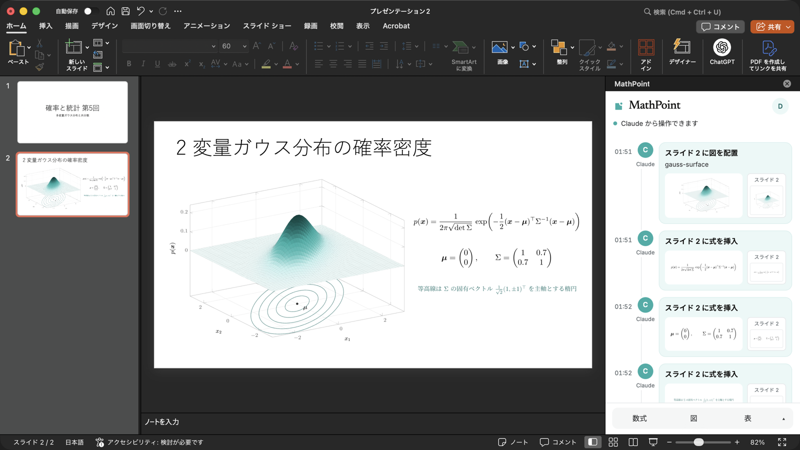

# MathPoint — LaTeX equations in PowerPoint and Word, no TeX install

MathPoint is an add-in for Microsoft PowerPoint and Word that puts LaTeX
equations, TikZ / pgfplots figures, and tables typeset with real TeX into the
slide deck or document you have open. Type LaTeX in its task pane, or ask Claude
or ChatGPT in chat. Typesetting runs on the MathPoint server with LuaLaTeX, so
you do not need TeX installed, and it works in PowerPoint for the web too.



- **Product page:** <https://tex64.com/mathpoint> (日本語: <https://tex64.com/ja/mathpoint>)
- **Guide:** <https://mcp.tex64.com/mathpoint/docs>
- **MCP server:** `https://mcp.tex64.com/mathpoint/mcp` (Streamable HTTP, OAuth sign-in with Google)

This repository holds the public connection details: the Claude plugin, the MCP
Registry entry, and this README. The MathPoint service itself is operated by
Fermion Inc.

## Get started

1. **Install the add-in** (PowerPoint and Word, Microsoft 365 or Office 2021 and later):

   ```sh
   # Mac (Terminal)
   curl -fsSL https://mcp.tex64.com/mathpoint/install | sh
   ```

   ```powershell
   # Windows (PowerShell)
   irm https://mcp.tex64.com/mathpoint/install.ps1 | iex
   ```

   On the web, use Add-ins → More Add-ins → My Add-ins → Upload My Add-in and
   choose [manifest.prod.xml](https://mcp.tex64.com/mathpoint/addin/manifest.prod.xml).

2. **Sign in.** Reopen PowerPoint or Word, open **Home → Add-ins → MathPoint**,
   and sign in with Google in the task pane.

3. **Connect your AI.** Choose Claude or ChatGPT in the task pane, or add the
   MCP server yourself:

   | Client | How |
   |---|---|
   | Claude (claude.ai, desktop) | Settings → Connectors → Add custom connector → `https://mcp.tex64.com/mathpoint/mcp` |
   | ChatGPT | Settings → Apps & Connectors → create a connector (developer mode) with the same URL |
   | Claude Code | `claude mcp add --transport http mathpoint https://mcp.tex64.com/mathpoint/mcp`, or install this plugin: `/plugin marketplace add Fermion-company/mathpoint-plugin` then `/plugin install mathpoint@mathpoint` |
   | Codex | `codex mcp add mathpoint --url https://mcp.tex64.com/mathpoint/mcp` |

4. **Ask.** Keep the task pane open and ask in chat.

## Use it without an AI

Like IguanaTex, MathPoint works on its own: open the task pane, type LaTeX,
check the live preview, and click **Insert**. TikZ code and tables copied from
Excel go in the same way. The LaTeX source is stored with the shape, so you can
open it again and re-typeset.

## How it compares

| | Local TeX | Rendering | Figures and tables | Word |
|---|---|---|---|---|
| PowerPoint equation editor (LaTeX input) | Not needed | Office math | No | Yes |
| IguanaTex | Required | TeX | If you write them in TeX | No |
| MathType (paid) | Not needed | MathType | No | Yes |
| **MathPoint** | Not needed | TeX (LuaLaTeX) | TikZ, pgfplots, tabularray | Yes |

IguanaTex is a VBA add-in, so it does not run in PowerPoint for the web; MathPoint does.

A longer comparison: [How to use LaTeX equations in PowerPoint: five ways compared](https://tex64.com/learn/latex-equations-in-powerpoint).

## Example prompts

- “Put the quadratic formula on slide 2.”
- “Make the equations on slide 2 teal and a bit larger.”
- “Add a slide with a 3D surface plot of a bivariate Gaussian.”
- “Redraw this hand-drawn circuit as a clean figure and put it on slide 3.”
- “Turn this table into a booktabs-style table with the decimals aligned.”
- “In my Word document, add Euler’s identity after paragraph 3, and make a ≠ 0 in the text inline math.”
- “Typeset Maxwell’s equations and show me the image.” (works without Office)

## Tools

| Tool | What it does | Annotation |
|---|---|---|
| `list_slides`, `list_layouts`, `word_read` | Read slides, layouts, and Word paragraphs | read-only |
| `insert_math`, `word_insert_math` | Typeset LaTeX with TeX and insert it (display, inline, or text mode) | write |
| `update_math`, `word_update_math` | Re-typeset a MathPoint shape with new LaTeX, size, or color | write, replaces |
| `render_math` | Return typeset math as a PNG without touching any file | read-only |
| `figure_guide`, `figure_start`, `figure_requests`, `figure_build`, `figure_place`, … | Build TikZ / pgfplots figures and tabularray tables, including redraws of sketches and screenshots, then place them | write |
| `set_text`, `add_text_box`, `add_slide`, `move_shape`, `delete_shape` | Edit ordinary PowerPoint text and layout | write |
| `word_insert_text`, `word_set_text`, `word_delete` | Edit Word paragraphs | write |
| `insert_image`, `word_insert_image` | Place an image as it is | write |
| `select_file`, `usage` | Choose which open file to edit; this month’s usage | — |

Edits appear in the open file right away and can be undone with Undo.

## Plans

The free plan covers 30 typeset equations, figures, or tables a month
(re-typesetting the same item does not count again). A paid plan without a
monthly limit costs 600 JPY a month, tax included. Check subscription availability,
your current plan, and cancellation at the [MathPoint account page](https://mcp.tex64.com/mathpoint/account?lang=en).
When subscriptions are available, stop renewal in **Manage or cancel**; access
continues until the end of the paid billing period.

## Privacy

Full policy: <https://mcp.tex64.com/mathpoint/privacy>. In short:

- MathPoint can edit only files where the MathPoint task pane is open.
- Slide and document content passes through the server only when your AI reads
  it; it is not stored.
- TeX sources and typeset results are kept for up to 30 days for your work.
- Sign-in uses Google. You can disconnect AI apps or delete your account at any
  time from <https://mcp.tex64.com/mathpoint/account>.

## 日本語

MathPoint は PowerPoint と Word に LaTeX の数式・TikZ の図・表を入れるアドインです。
作業ウィンドウに LaTeX を打つか、Claude や ChatGPT にチャットで頼むと、TeX で組んだ
結果が開いているスライドや文書に入ります。組版はサーバーで行うので、TeX の
インストールは要りません（IguanaTex と違い、Web 版の PowerPoint でも動きます）。

1. Mac はターミナルで `curl -fsSL https://mcp.tex64.com/mathpoint/install | sh`、
   Windows は PowerShell で `irm https://mcp.tex64.com/mathpoint/install.ps1 | iex` を実行します。
2. PowerPoint を開き直し、ホーム → アドイン → MathPoint を開いて Google でログインします。
3. 作業ウィンドウから Claude か ChatGPT をつなぎ、「スライド 2 に二次方程式の解の公式を入れて」のように頼みます。

無料プランは月30件まで、有料プランは月600円（税込）です。申し込みの受付状況・現在のプランは[アカウント](https://mcp.tex64.com/mathpoint/account?lang=ja)で確認できます。解約は「契約の管理・解約」から次回更新を停止し、支払済み期間の終了まで利用できます。詳しくは <https://tex64.com/ja/mathpoint#pricing> をご覧ください。

## Support

<contact@fermion.company> · <https://mcp.tex64.com/mathpoint/support>

## License

The files in this repository are MIT licensed. The MathPoint service is subject
to its [terms of service](https://mcp.tex64.com/mathpoint/terms).
